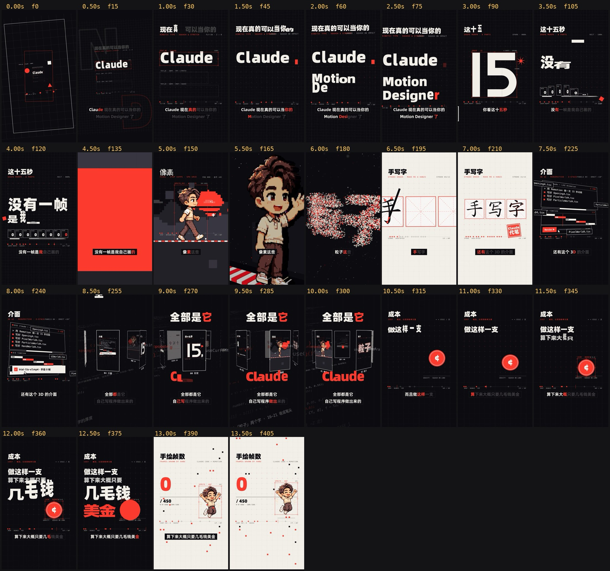

# sui-motion-graphic-reel

**用代码做出有设计感的动画 Reel。** 一个给 Claude Code 用的 skill：你讲要做什么，它写程序逐帧出片，不开 After Effects。

作者：**Sui Yang** · Instagram [@asksui.ai](https://www.instagram.com/asksui.ai/)



上面这张是我一支 Reel 开场 15 秒的联络表（每半秒一格）。它不是一次做出来的，同一天改了七版。这个 skill 装的就是那七版里学到的东西：怎么想、怎么跟 AI 讲、怎么在出片之前就把毛病挑掉。

## 它会做什么

你跟 Claude 说「帮我做一支动画」，它会照这个顺序走：

```
找 design system ──有──▶ 照你的做
        │
        没有
        ▼
你答几题，或丢参考 ──▶ 设计 agent 出三套（各附一张样张）──▶ 你选一套
        ▼
写稿、配音（拿每个字的时间）
        ▼
分镜先给你看，你点头才开做
        ▼
逐幕做画面
        ▼
渲染前审片：纸上审 → 机器量静态截图 → 审片 agent 照你的「审片习惯档」替你先挑一遍
        ▼
出片 → AI 自己放大再审一次 → 交给你，讲清楚看到什么、改了什么、还留着什么
```

三个设计上的重点：

- **口味是你的。** 颜色、字、要不要渐层，全部住在 design system 里，由你决定或由你选。skill 里附的范例只是起手，整份可以换。
- **手艺是固定的。** 全片一套语言、每一幕换一种做法、每一幕四层、镜头要自己动、一刻只有一个焦点。换什么风格都成立。
- **你挑过的毛病，不用挑第二次。** 你每看一次片讲一句「这里很空」「字被切到了」，它就记进你的审片习惯档；下一支片出片之前，它先照这份档替你查。

## 怎么装

需要 [Claude Code](https://claude.com/claude-code)（付费方案）。

**最省事**：把这一行贴给你的 Claude Code。

```
帮我装这个 skill：https://github.com/suiyang-meta/sui-motion-graphic-reel
放进我的 skills 资料夹，装好跟我说里面有什么。
```

**自己装（Mac / Linux）**：

```bash
git clone https://github.com/suiyang-meta/sui-motion-graphic-reel ~/.claude/skills/sui-motion-graphic-reel
```

**自己装（Windows PowerShell）**：

```powershell
git clone https://github.com/suiyang-meta/sui-motion-graphic-reel "$env:USERPROFILE\.claude\skills\sui-motion-graphic-reel"
```

装完重开 Claude Code。之后要更新，在那个资料夹里 `git pull`。

做片用的引擎（HyperFrames 或 Remotion）、ffmpeg、配音服务，Claude 会带你装，装之前会先讲每样是做什么的。

## 第一次用

直接讲你要做什么：

```
帮我做一支 15 秒的直式动画，介绍我店里新出的 ___。
气质要 ___，颜色我想用 ___。
```

没有想法也可以，只讲要介绍什么，它会问你几题，再出三套风格给你挑。

不满意就讲感觉：「很干」「很 static」「不够高级」「很乱」。它有一张对照表，知道每一种感觉该去改哪里。

## 里面有什么

| 档 | 是什么 |
|---|---|
| `SKILL.md` | 主档：整条流程、九条画面思路、把感觉翻成该改什么的对照表 |
| `references/design-system.md` | design system 的栏位与四份范例 |
| `references/design-agent.md` | 设计 agent 怎么出三套方案与样张 |
| `references/techniques.md` | 手法词汇表：每个手法附一句「怎么跟 AI 讲」 |
| `references/pre-render-review.md` | 渲染前审片三层怎么做 |
| `references/review-habits.md` | 审片习惯档：格式、41 条起手条目、怎么越用越准 |
| `references/engines.md` | 引擎怎么接、真 3D、配音、授权 |
| `references/case-0099.md` | 那支 15 秒片从第一版改到第七版的经过 |
| `examples/` | 每一版的联络表（正反例图），加一支别的口味的实测 |
| `scripts/preflight.py` | 渲染前量测：只看静态截图，不用出片 |
| `scripts/review.py` | 出片后自审：联络表、原尺寸截帧、连拍、扫定格 |

## 现在做到哪（照实讲）

第一个公开版本是 2026-11-12；2026-11-13 加了第九条思路与几处补充。

- 用它冷启动实测过三次：一个只读得到这个 skill 的 AI，分别替一家咖啡店做 15 秒片、替一位瑜伽老师出三套 design system、再把其中一套做成片。口味换得动，全片统一、每幕换做法、转场有看点都做得到。
- 实测做出来的片，层次比上面那张联络表薄，也没有做真 3D。它能把你带到「能看的第一版」，要到定稿还是要你来回几轮。
- 渲染前审片第一次实测漏了几条（连拍截得太粗、转场途中的格子没细看），照那次改过之后，拿一支 51 秒的片重测：另一个 AI 当审片人，三轮各抓到 12、10、3 条必改，出片后才发现的剩 2 条。同一次也发现做片的 AI 自己说「改好了」不可靠（第一轮的 12 条只真的改好 3 条），所以流程里加了「下一轮先核上一轮」。
- 第九条思路（节奏：疏密与明暗）是那支片之后加的，还没有别的片照着走过。
- 两支脚本只在 Mac 上跑过。Windows 上有问题请开 issue。

## 授权与署名

[CC BY 4.0](LICENSE)。可以用、可以改、可以商用，**但要标明出处**：

> 出自 Sui Yang（@asksui.ai）的 sui-motion-graphic-reel · https://github.com/suiyang-meta/sui-motion-graphic-reel

改过再分享的，请写明你改了什么。

范例图里的像素角色是我的个人形象，不在授权范围内，请不要拿去当你自己的角色用。

## 回馈

用了觉得哪里不顺、哪一条规则对你的口味不适用，开 issue 讲。做出来的片也欢迎在 Instagram 标我 [@asksui.ai](https://www.instagram.com/asksui.ai/)。
